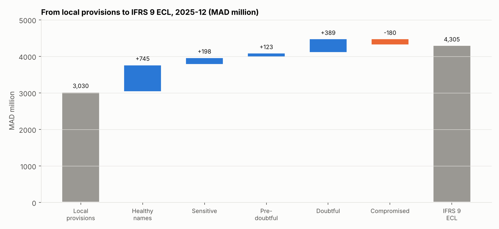
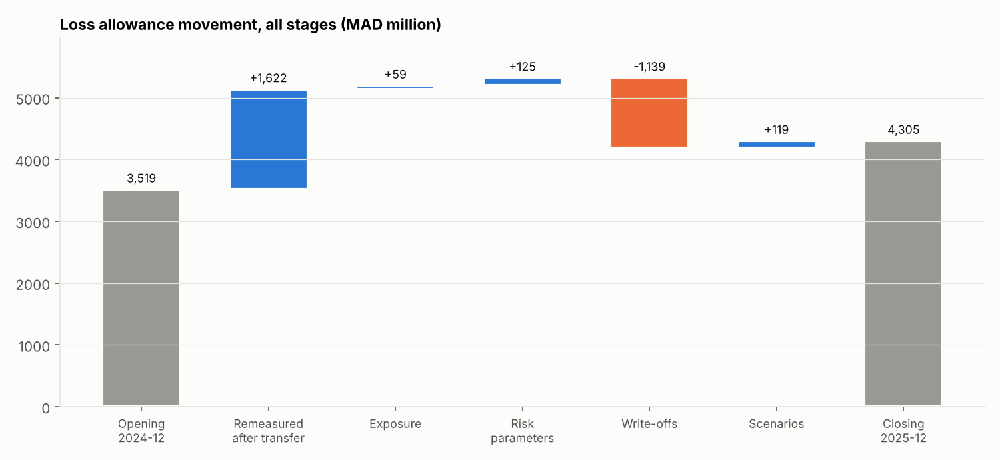
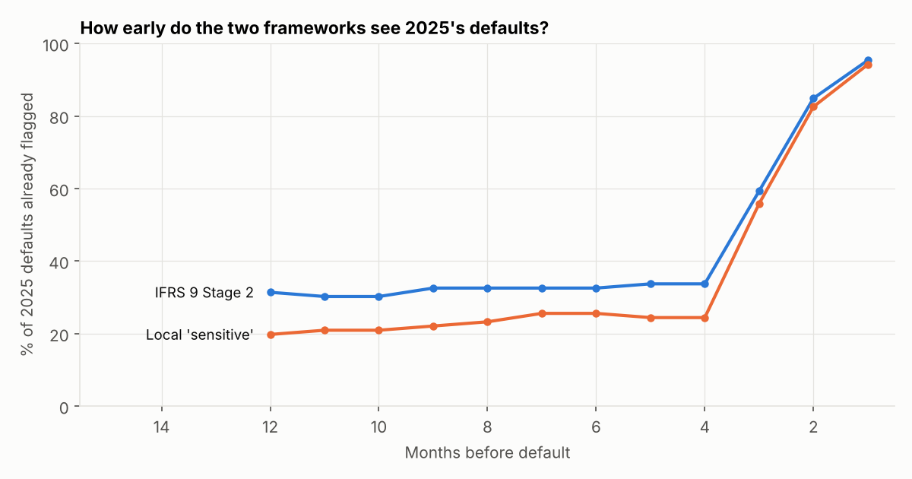
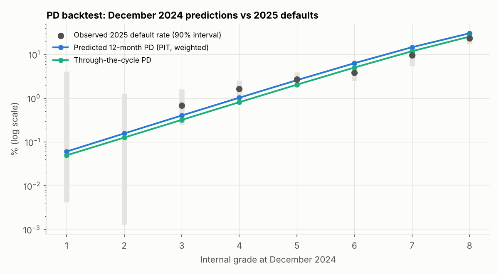
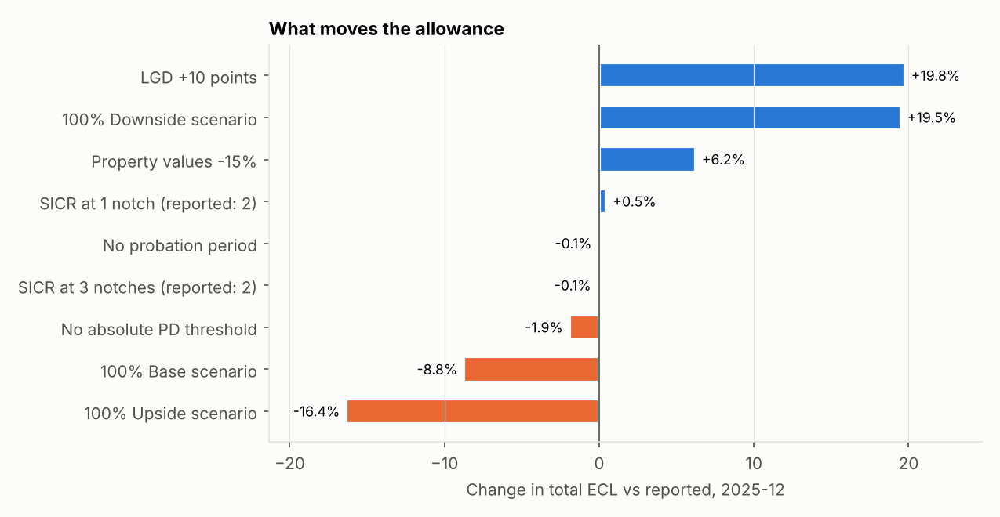

# IFRS 9 provisioning and reconciliation with local rules

**One corporate loan book, two provisioning frameworks: an IFRS 9 expected-credit-loss engine, and a line-by-line reconciliation with Bank Al-Maghrib's classification rules.**

> **Context.** I designed this reconciliation during my internship in the Counterparty Risk Surveillance department of a Moroccan bank (2026), as a proposal linking IFRS 9 staging to the local downgrade buckets. It was not implemented at the bank. This repository builds it afterwards on a **synthetic** portfolio (the same book as [credit-early-warning-system](https://github.com/ayoubAMEKZAZ1/credit-early-warning-system)) and on **public** data: the official IPAI property price index for collateral values, and public descriptions of the local rules. No bank data, systems or internal documents are used.

---

## The problem

Moroccan banks provision the same loans twice:
- **Consolidated accounts (IFRS 9):** expected losses from day one, lifetime losses once risk has risen significantly, weighted across macro scenarios.
- **Individual accounts (Bank Al-Maghrib circular 19/G):** flat minimums by age of arrears (20%, 50%, 100%), plus a new 10% "sensitive" class from 2027.

The two numbers never match. Finance and risk teams have to explain the gap every quarter: name by name, bucket by bucket, and from one quarter to the next.

## What it does

| Step | Module | Output |
|---|---|---|
| Facility layer | `facilities.py` | Term loan, overdraft and signature lines per name. EAD with CCFs. Mortgages indexed to the official IPAI. Public guarantees for SMEs |
| PD | `risk_params.py` | One-year migration matrix (2021-2023 only), smoothed PD by grade, lifetime PD from matrix powers, Vasicek forward-looking adjustment under three weighted scenarios |
| LGD | `risk_params.py` | Haircut collateral discounted over a 3.5-year recovery, unsecured recovery, guarantee cover, LGD rising with time in default |
| Staging | `staging.py` | Relative PD test (2 notches), low-credit-risk exemption, absolute threshold, 30-day backstop, watch list, 3-month probation |
| ECL | `ecl.py` | 12-month (Stage 1), lifetime (Stage 2), LGD × EAD (Stage 3), probability-weighted |
| Local rules | `local_rules.py` | Healthy / sensitive / pre-doubtful / doubtful / compromised, by counterparty, with minimum provisions on the net base |
| Reconciliation | `pipeline.py` | Stage × bucket matrix, bridge from local to IFRS 9, IFRS 7.35H allowance roll-forward, PD backtest, Stage 2 timing, sensitivities |
| Reporting | `report.py` | Markdown report, figures, and an **Excel reconciliation pack** with live formulas |

## Results (December 2025, MAD million)

| | Stage 1 | Stage 2 | Stage 3 | Total |
|---|---|---|---|---|
| EAD | 94,116 | 6,224 | 5,850 | 106,190 |
| IFRS 9 ECL | 684 | 548 | 3,072 | **4,305** |
| Coverage | 0.73% | 8.8% | 52.5% | 4.05% |

<p align="center"></p>

- **IFRS 9 needs 1.42x the local provisions** (4,305 vs 3,030). Under the legacy rules, without the sensitive class, local provisions would be 2,740, so the 2027 revision closes about a fifth of the gap.
- **The gap comes from timing, not loss severity.**
  - Names the local rules see as healthy carry 745 of IFRS 9 ECL.
  - On recent defaults, the flat 20% and 50% minimums sit below expected losses: +123 on pre-doubtful and +389 on doubtful loans.
  - On compromised loans it reverses (−180): the local 100% minimum ignores collateral recoveries that IFRS 9 counts.
- **Stage 2 sees defaults earlier than the local watch list.** Six months before default, 33% of 2025's defaulters were already in Stage 2, against 26% classified sensitive locally.
- **The PD model holds up out of time.** December 2024 predictions are slightly conservative against 2025 defaults (Stage 2: 21% predicted vs 16% observed), and most grades sit inside their 90% interval.
- **Scenarios and LGD drive the allowance; the staging details hardly do.**
  - A 100% downside scenario or LGD +10 points each adds about 20%.
  - A 15% fall in property prices adds 6%.
  - Moving the SICR threshold between 1 and 3 notches changes the total by under 1%.

<p align="center">
  
  
</p>
<p align="center">
  
  
</p>

Full tables: [`outputs/ifrs9_report.md`](outputs/ifrs9_report.md). Excel pack: [`outputs/reconciliation_pack_2025-12.xlsx`](outputs/reconciliation_pack_2025-12.xlsx).

### The Excel pack

The workbook is what a finance or risk team would review:
- **Live local provisions:** local provisions are recomputed with formulas from editable inputs (rates and collateral eligibility).
- **Formula-driven summaries:** the stage × bucket matrix and the bridge are `SUMIFS` over the counterparty sheet.
- **Built-in control:** the allowance roll-forward ends with a check against reported ECL.

Change a local rate on the *Assumptions* sheet and the bridge updates.

## Quickstart

```bash
pip install -r requirements.txt
python scripts/run_all.py      # portfolio -> ECL at 8 quarter-ends -> reconciliation -> outputs/ (about 10 s)
pytest                         # 8 tests: PD and LGD properties, ECL formulas, staging and local rules, totals that add up, no look-ahead
```

Every assumption sits in [`src/ifrs9/config.py`](src/ifrs9/config.py). [`docs/METHODOLOGY.md`](docs/METHODOLOGY.md) explains each step, and [`docs/LOCAL_RULES.md`](docs/LOCAL_RULES.md) gives the public sources for the local rules.

## Repository layout

```
src/ifrs9/
  config.py        all assumptions: products, CCFs, collateral, scenarios, SICR, local rates
  portfolio.py     synthetic counterparty panel (shared with credit-early-warning-system)
  facilities.py    facility terms, EAD, IPAI-indexed collateral
  risk_params.py   migration matrix, lifetime PD, Vasicek scenarios, LGD
  staging.py       SICR triggers and stage assignment
  ecl.py           12-month, lifetime and default ECL
  local_rules.py   local buckets and minimum provisions
  pipeline.py      reporting dates, bridge, movement, backtest, sensitivities
  report.py        figures, Markdown report, Excel pack
data/external/     official IPAI quarterly price changes (public)
outputs/           report, figures, CSV tables, Excel pack
```

## Limitations

- **Synthetic portfolio:** the results show the method, not any bank's numbers.
- **Simplified local rules:** the local rules are a simplified reading of public press descriptions of the circular. Check the text itself before any real use.
- **Narrow scope:**
  - No new or repaid names in the synthetic book.
  - No modification gains or losses.
  - No POCI assets.
  - No individual expert assessment of Stage 3 files.
- **Stand-in macro index:** the credit-cycle index stands in for a macro satellite model.

## Author

**Ayoub Amekzaz** · B.Sc. (Hons) Data Science, Cyprus International University · ayoub1am@icloud.com

Copyright © 2026 Cyprus International University. Code under the MIT license (see `LICENSE`).
